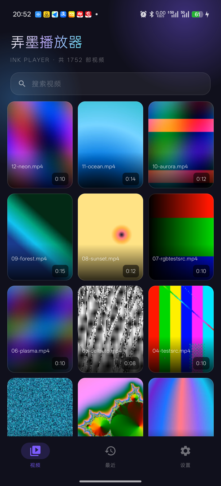
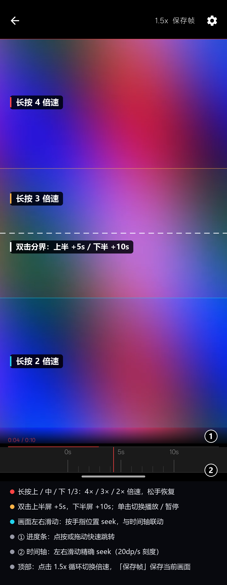

# 弄墨播放器

## 写在前面

总是找不到一个自己喜欢的播放器，于是自己写了一个。

## 截图

### 首页

### 播放页

## 功能

1. 单击：播放/暂停。
2. 进度条：可以快速拖动到指定位置。
3. 时间轴：
   1. 慢速拖动，画面同步。
   2. 支持播放的时候拖动，松手继续播放（这个我在其他支持时间轴拖动的播放器中没找到这个功能，全部都是松手就暂停了，要再点一下播放才会继续播放）。
   3. 支持全屏所有滑动，左右滑动控制的是时间轴，和时间轴上左右滑动一致。
4. 双击：屏幕分上下两个半屏。
   1. 双击上半屏：快进10秒。
   2. 双击下半屏：快进5秒。
5. 按住屏幕：屏幕分上中下三部分。
   1. 按住下部分：2倍速
   2. 按住中部分：3倍速
   3. 按住上部分：4倍速
6. 倍速：可以设置默认倍速，可以点击顶部的倍速切换倍速。
7. 保存帧：看到哪一个画面好看，可以保存那一帧，相当于截图。
8. 保存播放进度。

## 构建

直接 `./gradlew assembleDebug` 即可，`local.properties` 缺失时也能正常编译（产物为未签名包）。

签名信息从根目录 `local.properties` 读取（`signing.storeFile` / `signing.storePassword` /
`signing.keyAlias` / `signing.keyPassword`），未配置或找不到 jks 时自动跳过签名。